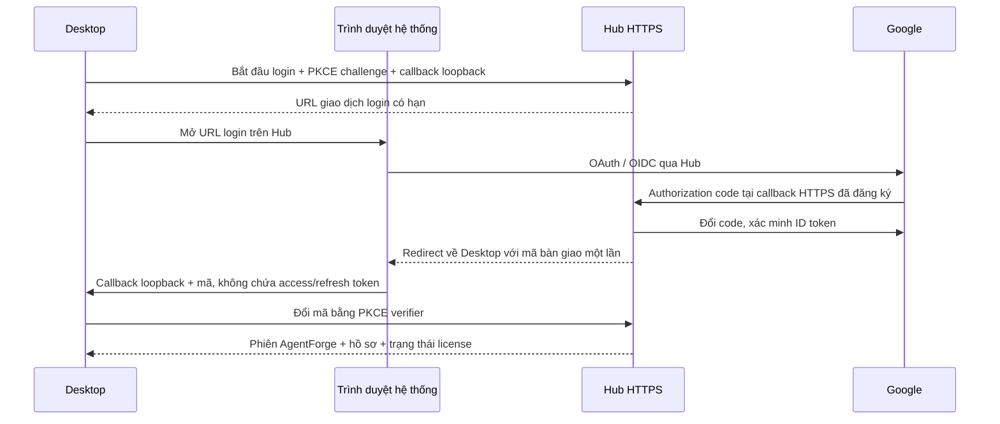

# Đề xuất liên kết Desktop, AI agent và đăng nhập Google

Ngày: **12/11/2026**. Trạng thái: **owner đã duyệt toàn bộ phương án; triển khai G1 → G5; Google login chưa được triển khai/vận hành**.
Đây là kịch bản sản phẩm và các cổng nghiệm thu đề xuất. Phần Docker admin
license/thiết bị/hồ sơ người dùng đang được hoàn thiện theo yêu cầu riêng.

Cập nhật thực thi: [ACCOUNT_LINKING_PROGRESS.md](ACCOUNT_LINKING_PROGRESS.md).
Các bảng hiện trạng bên dưới là khảo sát trước triển khai: source mới đã có
wizard/browser login CLI, Copilot worker tạm dừng thay vì dùng `--allow-all-tools`.

## 1. Hiện trạng kiểm tra được từ mã nguồn (snapshot trước triển khai)

| Thành phần | Đã có | Thiếu/điểm cần sửa |
|---|---|---|
| Agent local | Agents → Refresh detection; adapter Codex, Copilot, Antigravity; đăng ký CLI tùy chỉnh; phiên do CLI quản lý | Chưa có wizard kết nối cho người mới; tìm executable chưa chứng minh quyền chạy AI |
| GitHub Copilot | Gọi CLI để chạy task; check credential bằng một prompt ngắn | Check có thể tiêu quota; discovery đang đặt `available=True` trước khi xác minh login. Adapter còn dùng `--allow-all-tools`; cần thay bằng policy/sandbox được kiểm chứng trước khi coi Ready |
| IDE-only | Có handoff package khi phát hiện một số IDE/plugin | Chưa có cơ chế tự điều khiển mọi phiên VS Code/JetBrains. Login plugin không được dùng làm bằng chứng CLI đã sẵn sàng |
| BYOK | Form provider/model và OS keychain cho OpenAI/Anthropic/Gemini/Ollama | Cần nghiệm thu task thật với credential/model từng provider |
| Người dùng AgentForge | Docker admin đang có hồ sơ tên/email, khóa/mở và license gắn user ID | Hồ sơ quản trị chưa phải tài khoản đã xác minh Google; chưa có phiên đăng nhập Google của Desktop |
| License | Trial 14 ngày theo thiết bị, entitlement ký số, activation/revoke, staging Atlas đã test | Cần Hub HTTPS và public-key pin cho Desktop; `.env` server không tự cấu hình bản cài |

Nguồn: [registry.py](../backend/app/registry.py), [engine.py](../backend/app/engine.py),
[App.tsx](../dashboard/src/App.tsx), [license.py](../backend/app/license.py),
[Tauri shell](../dashboard/src-tauri/src/lib.rs).

Với bản hiện tại: người dùng cài/đăng nhập CLI qua nhà cung cấp, mở **Agents →
Refresh detection → Kiểm tra token**, chọn agent đó khi tạo task và cấu hình
validator cho repo. Copilot check hiện cần hiển thị rõ việc gửi một request.
Đây chưa phải hành trình kết nối một click hoàn chỉnh.

## 2. Phương án đề nghị duyệt

| Kết nối | Dùng để làm gì | Quyền được cấp |
|---|---|---|
| Google → AgentForge | Xác minh danh tính người dùng, liên kết hồ sơ/license/thiết bị | Phiên AgentForge và entitlement; không tự cấp quyền Copilot, Gemini hoặc GitHub repo |
| CLI/provider → AI worker | Thực thi task bằng thuê bao/credential của người dùng | Chỉ khả năng AI mà nhà cung cấp thực sự cho phép |
| Git/gh → repository | Clone/fetch/push/Draft PR theo repo đã chọn | Quyền repository; kiểm tra riêng trước publication |
| Admin token → Docker admin | Quản trị hồ sơ, key và thiết bị | Chỉ dành cho operator; không được cấp cho Desktop thông thường |

Copilot CLI hiện hỗ trợ OAuth browser/device flow, keychain và cả fallback từ
GitHub CLI khi không có credential ưu tiên hơn. App sẽ dùng luồng chính thức,
kiểm tra đúng tài khoản và quyền thực tế; không buộc người dùng đăng nhập lại
khi phiên hiện có đã hợp lệ. Xem [GitHub authentication](https://docs.github.com/en/copilot/how-tos/copilot-cli/set-up-copilot-cli/authenticate-copilot-cli).

Đề xuất **Google login để kích hoạt AI trial/paid**, nhưng vẫn cho đọc/export dữ
liệu local khi hết license hoặc mất mạng theo chính sách grace hiện có. Giữ
quyết định cũ: **trial 14 ngày theo thiết bị**, đăng nhập/đổi Google không reset
trial. Đây là đề xuất mở rộng xác minh danh tính, chưa phải thay đổi đã áp dụng.

## 3. Kịch bản A — Máy đã có AI agent

1. Người dùng mở Desktop, hoàn tất tài khoản/trial, vào **Kết nối AI**.
2. App tìm CLI trong PATH, các vị trí cài phổ biến và đường dẫn do người dùng
   chọn; hiển thị phiên bản và executable thực tế. Không tự cài bằng một lệnh
   shell lấy từ mạng hoặc tự thay đổi PATH toàn hệ thống.
3. Mỗi thẻ agent hiển thị trạng thái theo bằng chứng:
   **Chưa cài → Đã cài/chưa xác minh → Cần đăng nhập → Đã đăng nhập → Đã thử thành công**.
   Có trạng thái riêng cho hết quota, policy denied, mất mạng và cần nâng cấp CLI.
4. Bấm **Dùng phiên có sẵn**. Adapter kiểm tra auth bằng cơ chế chính thức hỗ
   trợ ở phiên bản CLI đó. Nếu không có phép kiểm tra không tốn quota thì báo
   **Chưa kiểm chứng request**; không biến kết quả version probe thành “đã đăng nhập”.
5. Người dùng chọn **Thử kết nối** nếu muốn. Khi test phải gọi model, app thông
   báo trước khả năng tiêu request/quota và không gửi source code trong probe.
   Người dùng cũng có thể dùng task fixture đầu tiên làm bằng chứng vận hành.
6. Chọn repo, validator, phạm vi file và số worker mặc định 1; chạy task fixture,
   xem diff/validation rồi complete local. Chỉ tăng concurrency theo cấu hình
   máy và giới hạn credential thực tế.

IDE-only được hiển thị **Handoff**, không gọi là worker tự động. BYOK tiếp tục
là lựa chọn riêng, có consent cho cloud và lưu key ở OS keychain.

## 4. Kịch bản B — Kết nối GitHub Copilot

**B1 — Đã cài và đã đăng nhập CLI:** phát hiện executable → dùng phiên hiện có
→ kiểm tra tài khoản/quyền theo khả năng CLI → test được người dùng cho phép
→ chọn Copilot làm worker. Chỉ hiển thị username/quota nếu lấy được dữ liệu
đáng tin cậy; trường không được CLI hỗ trợ phải ghi “không xác định”.

**B2 — Đã cài nhưng chưa đăng nhập:** bấm **Đăng nhập GitHub Copilot** → app
khởi chạy `copilot login --web-flow` qua adapter có allowlist argv → trình duyệt
hệ thống mở trang GitHub → người dùng chọn tài khoản/authorize → CLI hoàn tất
→ app kiểm tra lại. Nếu browser callback không dùng được, hỗ trợ lệnh chính
thức `copilot login --device-code`; mã một lần chỉ xuất hiện trong vùng login
tạm thời và được xóa khi kết thúc, không ghi vào event log.

Các lệnh trên được đối chiếu cả help của CLI cài trên máy và
[tài liệu GitHub](https://docs.github.com/en/copilot/how-tos/copilot-cli/set-up-copilot-cli/authenticate-copilot-cli).
Nếu phiên bản khác thiếu tính năng, app chuyển sang hướng dẫn terminal rõ ràng.

**B3 — Chỉ có Copilot trong IDE:** hướng dẫn cài CLI chính thức hoặc dùng
handoff. Không giả định phiên IDE luôn dùng được cho worker CLI.

**B4 — Sai tài khoản hoặc bị chặn:** hiển thị tài khoản đang xác minh, nguồn
credential và lỗi policy/subscription/SSO khi có bằng chứng. Chỉ kiểm tra sự
hiện diện của biến môi trường, không hiển thị giá trị. Biến
`COPILOT_GITHUB_TOKEN`/`GH_TOKEN`/`GITHUB_TOKEN` có thể ghi đè phiên OAuth; không
tự xóa credential/global env. Xem [thứ tự credential của GitHub](https://docs.github.com/en/copilot/how-tos/copilot-cli/set-up-copilot-cli/authenticate-copilot-cli).

**Điều kiện Ready quan trọng:** thay `--allow-all-tools` mặc định bằng quyền
file/tool/command và sandbox đã nghiệm thu. Chặn provider tự push/merge. Nếu
không thiết lập được ranh giới cần thiết trên máy/CLI đó, dùng handoff thay vì
báo worker tự động đã an toàn.

Không tự đọc/copy token của VS Code, browser cookie hoặc private credential
vào Hub. CLI giữ credential của chính nó; app chỉ giữ metadata và bằng chứng
trạng thái được phép. Keychain không khả dụng phải báo rõ, không âm thầm chấp
nhận cơ chế lưu plaintext. GitHub có mô tả fallback plaintext khi credential
store thiếu; sản phẩm cần chặn/giải thích tình trạng đó trong wizard.
[Nguồn](https://docs.github.com/en/copilot/reference/copilot-cli-reference/cli-command-reference).

## 5. Kịch bản C — Google xác minh tài khoản AgentForge

Đề nghị dùng **Hub làm OAuth/OIDC broker**. Google client secret ở server,
Desktop chỉ nhận phiên AgentForge qua giao dịch bàn giao một lần.

Chi tiết triển khai đề xuất:

1. Desktop bind callback `127.0.0.1` trên cổng tạm trước khi mở browser; Hub
   chỉ chấp nhận callback loopback/path theo allowlist, không nhận return URL tùy ý.
2. Giao dịch login có TTL, `state`, `nonce`, PKCE và ràng buộc client/device.
   Google OAuth callback cố định dạng `https://hub-domain/auth/google/callback`.
   Việc kiểm tra `state` tuân theo [hướng dẫn Google web-server OAuth](https://developers.google.com/identity/protocols/oauth2/web-server).
3. Chỉ xin `openid email profile`; không xin Gmail/Drive. Dùng middleware/thư
   viện OIDC/JWT đã được duy trì để kiểm chữ ký, issuer, audience, expiry,
   nonce và `email_verified`. Không tin email/avatar/user ID do Desktop tự gửi.
   [Google backend verification](https://developers.google.com/identity/sign-in/web/backend-auth).
4. Identity chính là cặp `provider=google` + `sub`; email là thuộc tính có thể
   thay đổi. Google chỉ rõ `sub` bền vững hơn email trong
   [OIDC reference](https://developers.google.com/identity/openid-connect/reference).
5. Hub tạo/liên kết hồ sơ người dùng và phát hành phiên riêng: access token
   ngắn hạn, refresh token opaque có rotation/revoke; chỉ lưu hash refresh token
   server-side, refresh credential Desktop nằm trong OS keychain. Google token
   dùng cho xác minh, không cần lưu Google refresh token để đọc dịch vụ khác.
6. Mã bàn giao browser → Desktop dùng một lần, TTL khoảng 60 giây và gắn PKCE;
   không đưa token phiên vào URL. Callback/query log ở Hub/proxy phải được lọc.
7. Hub kiểm tra user enabled, device/trial, license và device capacity; trả
   entitlement ký số đang có. Khóa user/revoke xử lý ở lần online verification
   tiếp theo; không hứa khóa tức thì thiết bị đang offline.

**Người dùng mới:** login Google → xác minh → hồ sơ được tạo → bind thiết bị →
hiển thị số ngày trial còn lại của thiết bị → chọn AI provider.

**Hồ sơ do admin tạo trước:** không tự gộp chỉ vì trùng email. Liên kết bằng
invite một lần/admin approval hoặc quy trình chứng minh quyền sở hữu license.
Đặc biệt email ngoài Gmail/Workspace không phải lúc nào Google cũng có thẩm
quyền xác nhận chủ sở hữu hiện tại; xem [Google backend auth](https://developers.google.com/identity/sign-in/web/backend-auth).

**Đã có license:** đăng nhập → gắn đúng chủ tài khoản qua quy trình trên →
activate key cho thiết bị theo limit; không tự chuyển license cho tài khoản mới.

**Đăng xuất/đổi tài khoản:** thu hồi phiên AgentForge và xóa credential phiên
riêng của app; giữ phiên CLI/provider bên ngoài. Task đang chạy cần được hoàn
tất hoặc cancel an toàn trước khi đổi account, giữ worktree/checkpoint. Remote
session do account cũ cấp cần được revoke khi đổi owner.

**Dữ liệu local:** đề nghị tách profile theo Hub user ID để lịch sử/task của hai
tài khoản không bị trộn trong app. Dữ liệu alpha cũ phải có backup và bước nhận
quyền sở hữu rõ ràng trước khi chuyển vào profile; không tự xóa/ghi đè. Đây là
phân tách trong app, không thay thế ranh giới bảo mật tài khoản hệ điều hành.

**Mất mạng:** local read/export vẫn có; quyền dispatch tuân entitlement/grace
và trạng thái phiên đã cache. Máy mới chưa xác minh Google không được giả lập
đăng nhập thành công. Giao dịch login bị hủy/hết hạn không tạo phiên còn sót.

## 6. Hạng mục server và Desktop dự kiến

- Hub: Google OAuth config/discovery; auth transaction; identities unique theo
  provider/sub; sessions/rotation/revoke; invite/claim hồ sơ; audit đăng nhập,
  liên kết thiết bị và khóa tài khoản. Admin token không biến thành user session.
- Admin web: user Google đã/chưa xác minh; linked identity, lần login cuối,
  số thiết bị/license; invite/approve claim, disable/revoke sessions. Không có
  nút lấy token AI/provider của người dùng.
- Desktop: trang Account; wizard Kết nối AI; adapter capability/version check;
  trạng thái auth rõ ràng; child-process credential policy; OAuth loopback bridge;
  OS keychain cho phiên app và profile theo user.
- Existing `/api/session` chỉ bootstrap local API token, không được dùng làm
  bằng chứng Google login. Entitlement/license và Google session là hai điều kiện
  kiểm tra riêng khi dispatch.

## 7. Thứ tự triển khai sau khi duyệt

| Bước | Công việc | Cổng nghiệm thu |
|---|---|---|
| G1 | Wizard agent local + chỉnh discovery/readiness + Copilot auth bridge + scope/sandbox | Máy có/không CLI, có/không login, sai account/env override, từ chối auth; test không tiêu quota ngầm; worker không vượt quyền |
| G2 | Google broker trong Hub + identity/session/invite + admin view | Callback thật trên HTTPS; sai state/nonce/audience, replay/expired code, PKCE sai bị chặn; user disabled bị từ chối; không tự merge email |
| G3 | Account UI + user profiles + session keychain + license/device binding | Login/logout/switch; legacy data backup/migration; đổi Google không reset trial; key thuộc user khác không tự chuyển; giữ local read/export |
| G4 | End-to-end trên máy sạch và server staging | Google → Copilot → fixture task → validation → diff → complete local; restart/offline/account revoke; không lộ credential trong log/backup |
| G5 | Image Hub mới và Desktop alpha mới | Container amd64/arm64, bộ cài 3 target, checksum; cấu hình Hub URL/public key đúng môi trường; ghi rõ signing/notarization còn thiếu nếu chưa có cert |

Không đổi cùng lúc sang account-based trial, auto-merge hay cloud-sync source.
Đó là các quyết định riêng ngoài phạm vi liên kết tài khoản này.

## 8. Thông tin cần khi triển khai Google thật

- Domain HTTPS bạn deploy Hub và callback URL chính thức.
- Google Cloud project + OAuth client loại Web Application cho broker,
  consent screen, test users/publishing phù hợp; client secret đưa vào secret
  manager hoặc env server, không dán vào chat và không đưa vào Desktop/image.
- Public key license của môi trường đó; chính sách chuyển hồ sơ cũ và invite.
- Một tài khoản GitHub có quyền dùng Copilot và repo fixture cho nghiệm thu
  có sự đồng ý tiêu request; không cần chia sẻ mật khẩu/token cho agent.

## 9. Gói quyết định đã được owner duyệt ngày 12/11/2026

1. Google xác minh tài khoản AgentForge trước khi kích hoạt AI; giữ local read/export.
2. Trial vẫn 14 ngày theo thiết bị; đổi/login Google không tạo trial mới.
3. Dùng CLI login chính thức cho AI, reuse phiên hợp lệ; probe tiêu quota phải rõ ràng.
4. Google OAuth broker ở Hub HTTPS; token app ở keychain; Google không tự cấp admin/Copilot/repo access.
5. Hồ sơ admin cũ liên kết qua invite/approval; profile local tách theo user; backup trước migration.
6. Triển khai G1 → G5, phát hành image/bộ cài mới sau end-to-end staging pass.
