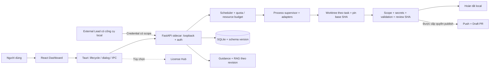

# Phân tích Desktop Product Spec và kế hoạch nâng cấp

Ngày khảo sát ban đầu: **11/11/2026**. Ngày rà soát bổ sung: **11/11/2026**. Nguồn yêu cầu: `docs/DESKTOP_PRODUCT_SPEC.md` (19 mục, 1.497 dòng).

Trạng thái: **đang triển khai theo phase** trên nhánh `codex/desktop-upgrade`, đồng bộ với repository `jtuongdang/agentforge`. Phần khảo sát ban đầu dưới đây được giữ làm lịch sử; tiến độ thực thi cập nhật ở mục Phase 0. Tài liệu này phân biệt yêu cầu trong spec, bằng chứng từ mã nguồn và quyết định kiến trúc đề xuất. Mã nguồn được dẫn theo phiên bản đang có trong workspace; số dòng có thể thay đổi sau refactor.

## 1. Kết luận để quyết định triển khai

Hệ thống hiện tại là một **orchestrator local có dashboard web**, đã có scheduler, worktree, contract gate, CLI adapters, validation, bounded recovery, lịch sử và RAG tài liệu. Chưa có Desktop shell, onboarding native, fleet slots, phiên Tech Lead, rescue worker, license hub hay remote pairing.

Nên triển khai theo thứ tự: **ổn định và bảo vệ lõi → cấu hình/onboarding → Desktop alpha → fleet → Tech Lead → rescue → code RAG → thương mại hóa → remote**. Có thể tái sử dụng nhiều module, nhưng không nên coi scheduler, validation và cleanup là thành phần đã hoàn thiện để giữ nguyên.

Mốc đầu tiên đề xuất là **Desktop alpha trên macOS arm64**: mở app, chọn repo, nhận diện CLI, tạo task, theo dõi log, xem đầy đủ diff, hoàn tất local hoặc tạo Draft PR sau duyệt. Windows và macOS x86_64 được kiểm chứng riêng ở mốc phát hành đa nền tảng.

Ước tính “70% giữ nguyên / 20% sửa / 10% thêm” và “~2 ngày” trong spec chưa có cơ sở đo. Phạm vi mới gồm nhiều subsystem và các lỗi lõi cần sửa trước. Không nên dùng các con số đó làm cam kết giao hàng.

## 2. Baseline đã kiểm tra

| Kiểm tra | Kết quả ngày 11/11/2026 | Ý nghĩa |
|---|---|---|
| `.venv/bin/python -m pytest backend/tests -q` (khảo sát ban đầu) | **37 passed, 1 failed**, 1 deprecation warning | Lỗi lịch sử do conventions chưa có; cập nhật lần chạy Phase 0 xem bên dưới |
| Test thất bại | `test_project_guidance_loads_root_and_scoped_agent_instructions`, `backend/tests/test_core.py:44` | Thiếu `docs/PROJECT_CONVENTIONS.md` mà code và test yêu cầu |
| `npm run build` tại `dashboard/` | Pass | TypeScript và Vite build được; chưa chứng minh Desktop chạy được |
| `npm run lint` tại `dashboard/` | Exit 0; **6 warnings**, 0 errors | Các cảnh báo về effect/dependency và biến trong async ở `App.tsx` |
| Cấu trúc Desktop | Không có `src-tauri/`, không có component onboarding | Chưa có nền tảng đóng gói native |
| Quản lý mã nguồn workspace (khảo sát ban đầu) | `git status` báo không có Git repository | Đã khởi tạo local baseline và nối remote sau khi owner gửi repo |
| Tài liệu tham chiếu lúc khảo sát đầu | README trỏ tới `PROJECT_CONVENTIONS`, `COMPLETION_ROADMAP`, `IMPLEMENTATION_PLAN`, `ENVIRONMENT_REPORT`, `OPERATIONS` nhưng lúc đó chưa thấy các file | Đã cập nhật lại bên dưới theo workspace hiện tại |

**Cập nhật khi rà soát lại:** `docs/PROJECT_CONVENTIONS.md` và `docs/COMPLETION_ROADMAP.md` đã có; README được sửa để chỉ liên kết tới tài liệu hiện hữu. `COMPLETION_ROADMAP.md` là roadmap hoàn thiện Orchestrator, còn tài liệu này lập kế hoạch cho Desktop; Desktop phụ thuộc vào các cổng chất lượng/bảo mật của roadmap Orchestrator, không thay thế chúng. Workspace ban đầu chưa có `.git`; sau khi owner gửi remote, đã khởi tạo branch `codex/desktop-upgrade`, tạo baseline local và nối remote GitHub rỗng.

**Đánh giá `PROJECT_CONVENTIONS.md`:** phù hợp làm quy ước nền và đã được `project_guidance.py` nạp vào task. Nội dung về synthetic data, secret, file scope, migration, xác minh và báo cáo khớp mục tiêu sản phẩm. Trước khi dùng làm chuẩn cho cả dự án, nên bổ sung quy ước Python/FastAPI, React/TypeScript và SQLite; hiện phần Java/Clean Architecture khá chi tiết nhưng không phản ánh cấu trúc code chính. Cụm “hướng dẫn gần file nhất (`AGENTS.md`) ưu tiên quy ước riêng của repo” cũng nên đổi: đề xuất thứ tự là task/contract → quy ước riêng của repo → `AGENTS.md` áp dụng trực tiếp tại path → quy ước nền, miễn không trái quy tắc an toàn bắt buộc. Đây là hạng mục cập nhật tài liệu trong Phase 0, không phải yêu cầu viết lại toàn bộ conventions.

Giới hạn khảo sát: đọc code, chạy suite hiện có và thử nghiệm fixture local; chưa test bản cài Desktop, Windows, quota thật, license server hay publish GitHub. Không chạy task AI trả phí và không push/merge repo của người dùng trong các thử nghiệm bổ sung.

## 3. Đối chiếu yêu cầu với hiện trạng

“Một phần” nghĩa là có nền móng nhưng chưa đủ hành vi mô tả trong spec.

| Yêu cầu trong spec | Hiện trạng | Bằng chứng / phần còn thiếu | Phase |
|---|---|---|---|
| Bỏ repo mặc định (§5–6) | Đã có | `main.py:35`: bootstrap không đăng ký repo mặc định; đã có test lịch sử | 1: giữ hành vi, thêm onboarding |
| Quy ước Agent (§6) | Đã có, cần hiệu chỉnh stack | `docs/PROJECT_CONVENTIONS.md` được nạp bởi `project_guidance.py`; trọng tâm hiện tại là Java dù lõi là Python/FastAPI và React/TypeScript | 0 |
| Chọn repo và kiểm tra môi trường (§3, §18) | Một phần | Có đăng ký path và kiểm tra Git/base; chưa native picker, chưa preflight theo stack | 1–2 |
| Đa framework (§5–6) | Một phần | `validation.py:33`: Maven auto và custom argv; chưa profile Node/Python/Go riêng | 1 |
| Nhận diện CLI/auth/quota (§2) | Một phần | `registry.py`: discovery, credential probe, quota có chọn lọc; chưa login flow/BYOK | 1, 7 |
| Git author theo user (§6.1) | Chưa | `git_ops.py:192`: còn author `DevAgent Orchestrator` | 1 |
| Worktree + scope + contract + recovery (§5–6) | Một phần | Có module, nhưng có lỗi phạm vi, cleanup và lifecycle bên dưới | 0 |
| Log thời gian thực và diff (§3, §18) | Một phần | Có WebSocket và textual diff; diff chỉ commit cuối, chưa split diff/reconnect hoàn chỉnh | 0, 3 |
| Fleet nhiều slot, hot apply (§12–14) | Một phần | Có `max_parallel`, chưa slot/run identity, API cập nhật fleet và global budget; refresh ghi đè capacity mặc định | 3 |
| External Tech Lead + activation (§7, §11–12, §17) | Chưa | Có REST task API; không có role/session/handshake/lease/handover | 4 |
| DAG trực quan (§5) | Chưa | Có dependencies trong dữ liệu; chưa graph UI | 3 |
| Auto-review / auto-merge (§5, §18) | Chưa | `approve-draft-pr` chỉ push và tạo Draft PR; không merge | 4: policy; 7: integration riêng |
| Rescue khi rate limit (§15) | Chưa | Retry hiện tại cùng agent; chưa phân loại lỗi, checkpoint và chuyển ownership | 5 |
| Disk guard/watchdog/backoff (§16) | Một phần | Có storage, prune, timeout; chưa reserve disk, terminate process tree, retry theo loại lỗi | 0, 3, 5 |
| Backup/restore portable (§16.6) | Một phần | `.devagent` đóng gói SQLite + Git bundle + tùy chọn uncommitted; restore remap repo/worktree và reconcile task/run; RAG rebuild, profile activation đang chờ packaged CI | 1, 7 |
| Hybrid code RAG (§19) | Một phần | `rag.py` chỉ index Markdown bằng FTS5/BM25; DB riêng `rag.sqlite3`; chưa AST/symbol graph | 6 |
| Tauri + backend binary (§4–6) | Một phần | Shell, lifecycle, per-target sidecar và build/smoke matrix đã có; ARM64 runner, DMG packaging ổn định, signing và updater còn thiếu | 2, 7 |
| Google login/trial/license (§8–10, §18.2) | Chưa | Chỉ có thiết kế và code mẫu trong spec | 7 |
| Remote QR (§3) | Chưa | Launcher bind loopback; chưa pairing, transport và quyền remote | 8 |

## 4. Các vấn đề cần xử lý trước khi mở rộng

### 4.1. P0 — Cleanup có thể chọn xóa worktree còn dữ liệu chưa bảo toàn

`worktrees.py:45` coi remote-tracking branch tồn tại là đã push; `:133` coi có `pr_url` là đủ để xóa. Nhánh có thể có commit mới chưa push hoặc file chưa commit. Đường xóa dùng `git worktree remove --force`, sau đó fallback `shutil.rmtree` (`:158`). Chưa kiểm tra dirty state, độ khớp SHA remote, managed-root containment hay ownership với worker đang dùng.

`handoff_ready` không có trong `ACTIVE_STATUSES` của cleanup (`:12`), dù vẫn là công việc người dùng đang làm. `_clean_targets_in_worktree` xóa thư mục tên `target` mà không kiểm tra có source được Git theo dõi bên trong. Scheduler tự gọi prune khi khởi động vòng lặp và sau đó mỗi giờ (`scheduler.py:48`), nên đây không chỉ là rủi ro từ nút bấm.

**Đã tái hiện bằng dry-run:** fixture `draft_pr` cũ có file `uncommitted.txt` vẫn được chọn vào `fully_removed_count=1`. Chỉ chạy dry-run; fixture không bị cleanup xóa.

**Tiêu chí sửa:** chỉ xóa trong vùng quản lý; bảo vệ trạng thái active/handoff/review/rescue; xác minh không có process owner; kiểm tra staged/unstaged/untracked và commit cần giữ; có snapshot hoặc bằng chứng bảo toàn đúng SHA; recheck ngay trước xóa. Không dùng tên thư mục, URL PR hay remote ref tồn tại làm bằng chứng duy nhất. Cleanup build artifacts không được xóa file tracked. Mặc định preview trước, cơ chế tự dọn chỉ bật lại sau khi đủ kiểm chứng.

### 4.2. P0 — Scope và review chưa bao phủ toàn bộ thay đổi của task

`git_ops.py:144` chỉ lấy diff commit khi không còn thay đổi chưa commit. Nếu worker commit `a.py` rồi sửa tiếp `b.md`, danh sách kiểm tra chỉ còn `b.md`. Scope và secret scan có thể bỏ sót `a.py`. `task_diff` (`:160`) dùng `git show <commit>`, chỉ hiển thị patch commit cuối thay vì toàn bộ task.

**Đã tái hiện:** fixture có commit sửa `a.py` và thay đổi chưa commit ở `b.md` trả về `changed_paths == ['b.md']`; khi commit tiếp `b.md`, preview không chứa `a.py`.

**Tiêu chí sửa:** lưu `base_sha` bất biến khi tạo worktree; lấy hợp của thay đổi từ base tới task head và staged/unstaged/untracked, xử lý delete/rename. Review, scope scan, secret scan, validation và publish phải cùng trỏ tới một task revision. Lưu `validated_head_sha`; khi HEAD hoặc nội dung thay đổi sau kiểm định, kết quả review/validation phải hết hiệu lực. Trước publish kiểm tra lại SHA và trạng thái sạch.

### 4.3. P0 — Validation có đường bỏ qua kiểm thử sai

`validation.py:37` bỏ build cho mọi path bắt đầu bằng `docs/`, bất kể đó là code hay cấu hình thực thi. Cơ chế này còn chạy trước custom validator.

**Đã tái hiện:** `paths=['docs/runtime.py']` được trả `passed=True`, `profile='docs_skip'`, không chạy validator.

**Tiêu chí sửa:** docs-only phải là policy tường minh dựa trên loại nội dung và cấu hình repo; không tự bỏ custom check bắt buộc. Áp dụng trên toàn bộ changeset của task, không chỉ file đang dirty. Không dùng “build pass” như bằng chứng mọi acceptance criterion đã đạt.

### 4.4. P0 — Local API chưa xác thực quyền điều khiển

`main.py` có CORS allowlist nhưng không có authentication/authorization cho REST và WebSocket. Các route có thể đăng ký `exec` adapter, tạo task, duyệt publication và cleanup. Confirmation text ở Draft PR là xác nhận thao tác, không xác thực danh tính. Loopback giới hạn kết nối mạng nhưng không phân quyền client local.

**Tiêu chí sửa:** token phiên cho UI/backend; credential riêng có scope cho external lead; kiểm tra Origin/Host phù hợp; bảo vệ WebSocket; revoke/rotate; mặc định không cấp publish/cleanup cho lead. Không đặt token vào URL/query log hoặc prompt được lưu lâu dài. Thiết kế quyền khác nhau cho desktop owner, lead và remote viewer.

### 4.5. P1 — Hủy task chưa bảo đảm dừng tiến trình con

`engine.py:229` tạo subprocess nhưng không có cleanup process trong nhánh cancellation của `_invoke`; timeout gọi `proc.kill()` cho process trực tiếp. Validator cũng có timeout riêng và không có quản lý cây tiến trình thống nhất. Slot có thể được trả trong khi descendant vẫn ghi worktree.

**Tiêu chí sửa:** abstraction quản lý process tree theo OS; graceful stop rồi force stop; chờ xác nhận đã dừng mới trả slot/chuyển worker/cleanup. Test phải có process con thật. Pause/resume chỉ hiển thị khi adapter/OS có semantics đã được kiểm chứng; alpha hỗ trợ cancel, không giả lập pause.

### 4.6. P1 — Dependency “xong” không đồng nghĩa code đã nằm trong base

`scheduler.py:14` coi `awaiting_pr_approval`, `draft_pr`, `completed` là dependency thành công. Nhưng task sau tạo worktree từ base branch, không tự có commit của task trước. Ví dụ B cần class do A tạo sẽ thiếu class dù A đã pass test và chờ duyệt PR. Contract đồng bộ interface không tự tích hợp implementation.

**Tiêu chí sửa:** phân biệt dependency về quyết định/contract với dependency cần code. Loại cần code chỉ chạy khi commit đã được tích hợp vào base được chọn, hoặc trên integration ref có pin SHA và provenance rõ ràng. Không đánh đồng Draft PR, local completion và merged.

### 4.7. P1 — Dữ liệu vận hành và state cần hợp nhất

- `db.py`, worktree, handoff, RAG, static assets đang dựa vào source root; không phù hợp trực tiếp với bundle cài đặt hoặc thư mục giải nén onefile.
- Migration là `ALTER TABLE` cộng dồn chưa có schema version và quy trình backup/restore theo release.
- Một số nhánh `break`/cancellation trong execution có thể kết thúc task mà run chưa được finalize. Cần invariant: mọi run kết thúc đều có trạng thái, exit reason và timestamp.
- Guidance/RAG hiện đọc từ source checkout trước khi chuẩn bị worktree (`engine.py:80`); có thể khác branch và chứa nội dung chưa commit của người dùng. Context phải gắn repo + base SHA/task revision.
- Event `details`, report, diff và các kênh log cần redaction thống nhất; regex hiện tại chưa chứng minh bao phủ mọi provider secret hoặc PII. Log kỹ thuật có retention, khác với audit milestone; README/spec cần mô tả đúng việc prune hiện có.

## 5. Các giả định trong spec cần chỉnh

| Nội dung spec | Điều chỉnh đề xuất |
|---|---|
| “100% On-Premise”, không dòng code nào rời máy | Tách lưu trữ/điều phối local khỏi suy luận. Adapter dùng cloud gửi prompt/context tới provider. Offline chỉ là chế độ riêng khi toàn bộ model và dependency cần thiết có sẵn local. |
| Tất cả phiên CLI tự được Keychain cấp | Dùng CLI auth command chính thức; không tự đọc token của provider. Codex có nhiều chế độ credential store, gồm cả file; không mặc định luôn Keychain. Theo [OpenAI Docs về authentication](https://learn.chatgpt.com/docs/auth). |
| Dán prompt là ChatGPT/Codex tự gọi được localhost và sáng đèn xanh | Codex có công cụ local theo quyền môi trường; cần xác định surface và bridge cụ thể. Suy luận thiết kế: copy prompt chỉ hỗ trợ hướng dẫn, không phải proof of connection. Dùng handshake có xác thực, session ID và heartbeat; `GET /health` không xác nhận vai trò Tech Lead. [OpenAI Docs về Codex CLI](https://learn.chatgpt.com/docs/codex/cli). |
| `approve-draft-pr` gộp code vào main | Sửa toàn bộ prompt và UX: đây là **push + Draft PR**, không merge. Auto-merge cần API, policy, quyền và kiểm định riêng. |
| Nhiều tab cùng provider có quota độc lập | Slot chỉ là năng lực thực thi. Credential/account là nguồn quota dùng chung; lead và worker có thể cạnh tranh cùng hạn mức. Chỉ hiển thị quota thật khi provider cung cấp dữ liệu đáng tin cậy. |
| Biên dịch Nuitka là chống dịch ngược 100% | Xem như lựa chọn đóng gói và tăng chi phí phân tích, không bảo đảm tuyệt đối. Chứng minh bằng binary chạy trên máy sạch; không dùng obfuscation làm ranh giới bảo mật. |
| Một lệnh compile `backend/app/main.py` là đủ | Hiện file dùng relative imports và chỉ khai báo FastAPI app. Cần executable entrypoint khởi động server, resource paths và build theo target. Nuitka standalone/onefile có thể bỏ yêu cầu cài Python ở máy đích; đó không phải bằng chứng script mẫu đã chạy được. [Nuitka Manual](https://nuitka.net/user-documentation/user-manual.html). |
| Tauri shell <30 MB / <50 MB RAM | Đặt ngân sách đo cho cả shell, backend, CLI, build và model; đo riêng idle và tải. Sidecar phải có binary theo target triple và quyền invoke cụ thể. [Tauri Sidecar](https://v2.tauri.app/develop/sidecar/), [Tauri Capabilities](https://v2.tauri.app/security/capabilities/). |
| HWID hash là ẩn danh và bất biến tuyệt đối | Xem là định danh thiết bị có khả năng thay đổi/collision/spoofing, cần quy trình đổi máy. Spec vừa ghi “không thu thập dữ liệu cá nhân” vừa lưu IP/email; phải thống nhất mô tả dữ liệu và retention. Không dùng kết luận pháp lý từ spec làm tiêu chí kỹ thuật. |
| Revoke license tự xóa dữ liệu tạm | Đề xuất chỉ hạn chế khởi chạy tính năng có license; cho phép đọc lịch sử/export, bảo toàn worktree và xử lý an toàn run đang chạy. Không để license service điều khiển xóa code người dùng. |
| License hub “0đ trọn đời / 24×7”, core planner trên cloud | Chi phí/availability phải khảo sát riêng tại lúc chọn hạ tầng. Cloud planner cần opt-in và data boundary rõ ràng; không đưa vào MVP local. |
| RAG loại trùng lặp 100%, giảm token 75%, index 1,5 giây | Chuyển thành giả thuyết cần benchmark trên tập repo có kích thước xác định; không cam kết trước khi đo. Hiện mới có Markdown retrieval. |
| Snapshot DB phục hồi toàn bộ dự án | SQLite snapshot đơn lẻ chưa đủ. Luồng `.devagent` hiện ghép metadata với Git bundles và opt-in working-tree overlays, scrub credentials/local paths rồi remap/reconcile khi restore; RAG index cần rebuild. |

Code mẫu License Hub ở §10.3 cũng chưa sẵn sàng production: kiểm tra rồi thêm thiết bị không atomic; activation chưa kiểm tra `ExpiresAt`; verify đọc device status không tái đối chiếu license bị revoke/hết hạn; chưa có signed offline entitlement. Đây là backlog Phase 7, không phải implementation đã có.

## 6. Kiến trúc đích đề xuất

Các nguyên tắc triển khai:

1. Giữ Python backend làm lõi; Rust shell phụ trách native/lifecycle. Không viết lại scheduler bằng Rust chỉ để đóng gói.
2. Gom cấu hình `app_data_dir`, `db_path`, `worktrees_dir`, `handoffs_dir`, `rag_path`, `resources_dir`, host/port và timeouts vào một nguồn cấu hình. Tách thư mục writable khỏi tài nguyên bundle readonly.
3. Giữ REST cho headless/external lead. UI có API transport riêng cho web dev và Desktop; xử lý HTTP lẫn WebSocket, không giả định luôn cùng origin hay cổng 8765.
4. Chọn cổng có cơ chế discovery và xác minh đúng instance. Không attach nhầm service đang chiếm cổng; external client cần endpoint và credential đã cấp, không chỉ URL hardcode.
5. Một backend owner cho mỗi data directory ở giai đoạn đầu. Nếu cần nhiều process scheduler, phải có reservation/capacity/scope leases bền vững; atomic claim từng task hiện tại chưa giải quyết tổng capacity giữa process.
6. Phân biệt `provider`, `credential_profile`, `agent configuration`, `worker_slot`, `run`, `lead_session`. Giữ `agents` làm cấu hình executor hiện tại; migration bổ sung dần thay vì tạo lại dữ liệu.
7. Tách quyền review, hoàn tất local, publish Draft PR và merge. Mặc định lead chỉ được tạo task/review theo repo được cấp; quyền mở rộng do owner cấu hình.

## 7. Các phase nâng cấp

Ước lượng dưới đây là **ngày công kỹ thuật cho một người**, gồm implementation và kiểm chứng trong phạm vi nêu ra; chưa phải deadline. Cần hiệu chỉnh sau Phase 0 và spike Desktop. Không tính thời gian chờ tài khoản ký số, review store hoặc sự cố dịch vụ bên ngoài.

| Phase | Đầu ra | Ước lượng | Phụ thuộc |
|---|---|---|---|
| **0 — Ổn định và bảo vệ lõi** | Baseline xanh; cleanup, changeset, validation, process và auth gates đủ tin cậy | 4–7 ngày | Bắt đầu ngay |
| **1 — Cấu hình và onboarding backend** | App data paths, migration, preflight, Git identity, validator profiles | 4–6 ngày | 0 |
| **2 — Desktop alpha** | Tauri macOS arm64, sidecar, native picker, wizard, bản cài nội bộ | 6–10 ngày | 1 |
| **3 — Fleet và quan sát** | Slot identity, hot apply, global budget, log/diff/DAG UI | 5–8 ngày | 0–2 |
| **4 — External Tech Lead** | Activation, xác thực session, quyền, heartbeat, handover | 4–7 ngày | 0–3 |
| **5 — Rescue và retry có kiểm soát** | Phân loại lỗi, cooldown, checkpoint, đổi worker an toàn | 5–9 ngày | 3–4 |
| **6 — Code Context Engine** | RAG theo revision + parser/symbol cho stack ưu tiên | 5–9 ngày | 0–1; tích hợp sau 5 |
| **7 — Phát hành và thương mại hóa** | Đa nền tảng, ký số/update, BYOK/Ollama, license/trial, portable backup | 7–12 ngày cho phạm vi hẹp; chia subphase | 2–6 ổn định |
| **8 — Remote pairing** | Phiên remote có giới hạn quyền, thu hồi và transport an toàn | 4–7 ngày | Auth của 0/4; release ổn định |

Tổng sơ bộ **44–75 ngày công** cho phạm vi hẹp ở từng phase; Phase 7 mở rộng nhiều provider, nền tảng và billing sẽ cần ước lượng riêng. Mốc Desktop alpha sau Phase 0–2 khoảng **14–23 ngày công** theo giả định này. Đây là ước lượng triển khai tuần tự, chưa trừ thời gian làm rõ requirements, sửa trên nhiều OS, ký số, phân phối beta và phản hồi người dùng. Sau Phase 0 phải cập nhật estimate bằng issue/task breakdown và spike Tauri. Các nhánh như code RAG có thể sắp lại sau khi lõi và dữ liệu đã ổn định.

### Trình tự triển khai và cổng quyết định

1. **Khởi động — không phát triển feature mới:** đưa workspace vào checkout có version control; xác nhận branch/base và nơi lưu dữ liệu. Rà soát conventions, cập nhật các link tài liệu sai trong README, lập danh sách vấn đề đang mở. Không cherry-pick hoặc ghi đè file người dùng để tạo checkout.
2. **Làm Phase 0 theo thứ tự:** 0A kiểm tra task revision/diff/scope/secret; 0B chặn cleanup nguy hiểm và thêm dry-run/recheck; 0C validation policy + auth REST/WS; 0D process tree, dependency/state invariants, log redaction và guidance theo revision. Chốt một thay đổi dữ liệu/API nhỏ trước khi sửa các module khác cùng phụ thuộc.
3. **Cổng G0:** suite backend xanh sau khi có regression cho phát hiện §4; dashboard build pass; cleanup fixtures chứng minh source/dirty/handoff/review không bị xóa; request không xác thực bị từ chối. Nếu chưa đạt, không khởi động Tauri hoặc fleet.
4. **Phase 1 rồi spike Phase 2:** hoàn tất config/data paths và onboarding API. Sau đó spike đóng gói backend độc lập, chọn sidecar/lifecycle và port discovery trên macOS arm64. Nếu spike không chạy ổn trên máy sạch, điều chỉnh estimate Desktop trước khi xây wizard đầy đủ.
5. **Cổng G1 — Desktop alpha:** chạy được vòng đời app và fixture repo end-to-end, diff đầy đủ, hoàn tất local; không có process sót sau đóng app và dữ liệu giữ qua lần mở lại. Khi đạt, mới mở beta nội bộ.
6. **Sau alpha:** Phase 3 (fleet) → Phase 4 (lead/session) → Phase 5 (rescue). Giữ manual approval làm mặc định; chỉ thêm tự động hóa khi có session auth, quyền và revision pin.
7. **Nhánh song song sau lõi:** Phase 6 RAG có thể nghiên cứu riêng, nhưng merge tích hợp sau pin revision/context contract. Phase 7A release pipeline là điều kiện phát hành rộng; BYOK, license và portability có thể chia release riêng. Phase 8 remote chỉ bắt đầu sau threat model và kiểm chứng auth/session.

Mỗi phase cần có: (a) API/schema/UX decision đã duyệt, (b) thay đổi trong scope có diff review được, (c) kiểm định tự động cho invariant mới, (d) hướng dẫn vận hành/migration tương ứng, và (e) demo acceptance flow. Không bắt đầu phase phụ thuộc chỉ vì code đã merge; phải đạt cổng nghiệm thu ghi dưới phase đó.

### Phase 0 — Ổn định và bảo vệ lõi

**Công việc:** xử lý §4; chuẩn hóa state transitions/invariants; cập nhật conventions cho stack Python/FastAPI, React/TypeScript và SQLite; sửa thứ tự ưu tiên guidance; cập nhật README cho đúng cleanup/log retention và loại link tài liệu sai; tạo baseline có quản lý phiên bản.

**File chính:** `docs/PROJECT_CONVENTIONS.md`, `README.md`, `backend/app/{git_ops,worktrees,validation,engine,scheduler,main,db,project_guidance}.py`, `backend/tests/test_core.py`.

**Thứ tự thực hiện:** (1) khôi phục Git baseline và chốt API/data invariants; (2) tạo changeset chuẩn dựa trên base SHA; (3) áp dụng changeset vào scope/secret scan, diff và validation; (4) khóa cleanup tới khi có ownership/dirty checks; (5) thêm API/WS auth và role scopes; (6) quản lý process tree và state/dependency; (7) cập nhật guidance/log redaction/docs.

**Điều kiện hoàn thành:** suite xanh; đủ regression cho commit hỗn hợp, nhiều commit, docs executable, dirty cleanup, đổi SHA sau validation, cancel process tree, dependency integration; REST/WS từ client chưa được cấp quyền bị từ chối. Không yêu cầu chạy AI thật để chứng minh các invariant này.

**Tiến độ thực thi (11/11/2026):** Phase 0 đã hoàn tất và push commit `8ea7d57` lên `codex/desktop-upgrade`. Changeset/diff dùng base SHA; cleanup preview và chỉ xóa worktree sạch đã tích hợp; docs-only policy không bỏ validator bắt buộc; API local có token, WebSocket dùng ticket một lần; process-group cancellation; dependency cùng repo và commit đã vào base; revision được kiểm tra trước review/publish/complete. Tại cổng G0: **45 passed**; dashboard production build pass; lint exit 0 với 6 warning React; `git diff --check` sạch.

### Phase 1 — Cấu hình và onboarding backend

**Công việc:** `Settings` thống nhất; versioned migrations + backup trước migration; empty-state/`needs_onboarding`; preflight kiểm tra Git, repo, base, disk, CLI và validator theo stack; đọc Git identity theo repo trước global và cho cấu hình fallback. Maven/Node/Python/Go dùng profile và argv được xem trước, không tự chạy script repo chỉ để “quét môi trường”.

**Đầu ra:** API setup/status và preflight; schema cho cấu hình được persist, credential chỉ là reference; manifest snapshot ở mức thiết kế. Tên endpoint mới phải được chốt bằng OpenAPI trước khi dùng trong prompt/UI.

**Điều kiện hoàn thành:** DB trống vào onboarding; repo bất kỳ hợp lệ đăng ký được; repo dirty báo rõ worktree chỉ lấy committed base; thiếu tool/identity/validator có hướng dẫn cụ thể; dữ liệu cũ nâng cấp được từ snapshot test; không viết vào bundle.

**Thứ tự thực hiện:** cấu hình đường dẫn → versioned migration/backup → preflight API → validator profiles → Git identity → onboarding UI contract. Định dạng settings và response phải ổn định trước khi Desktop tiêu thụ.

**Tiến độ thực thi (11/11/2026):** Phase 1 đã hoàn tất trên working tree sau Phase 0. Đã thêm cấu hình tập trung, writable data directory theo platform khi đóng gói, schema `user_version` + snapshot SQLite trước migration, API setup status/preflight (Git/base/dirty/disk/validator/Agent CLI), profile Maven/Node/Python/Go/custom theo argv, Git identity repo-local/global/fallback và cấu hình host/port loopback. Kiểm định: **50 passed**; dashboard production build pass; lint exit 0 với 6 warning React; snapshot CLI khởi chạy được; `git diff --check` sạch. Chưa đóng gói ứng dụng native ở phase này.

### Phase 2 — Desktop alpha

**Công việc:** spike executable entrypoint và bundle backend trước; Tauri start/ready/shutdown/crash recovery; single instance; port discovery; native folder picker; wizard ba bước; transport HTTP/WS; PATH khác nhau giữa Finder và terminal; quyền dialog/shell tối thiểu và CSP.

**File mới dự kiến:** `src-tauri/`, `backend/desktop_entry.py`, `dashboard/src/lib/api.ts`, `dashboard/src/components/Onboarding/`, scripts build theo nền tảng. Tên file là đề xuất, chưa tồn tại.

**Điều kiện hoàn thành:** bản cài nội bộ chạy trên macOS arm64 sạch không cần Python/npm của developer; chọn folder có dấu/khoảng trắng; không attach nhầm port; đóng app không để subprocess mồ côi; dữ liệu còn sau reopen; chạy trọn flow fixture repo → task → validation → full diff → complete local. Draft PR được test bằng mock và chỉ smoke thật khi có repo thử nghiệm được cấp.

**Phạm vi alpha:** dùng CLI đã cài/đăng nhập, manual review; chưa cần Google login, license server, BYOK, auto-merge hoặc remote.

**Thứ tự thực hiện:** build/run sidecar tối thiểu → lifecycle/readiness/port discovery → data paths → Tauri permissions/dialog → API + WebSocket transport → onboarding → máy sạch smoke flow → đóng gói beta nội bộ.

**Tiến độ thực thi (11/11/2026):** đã dựng Tauri v2 shell cho macOS arm64, backend sidecar Nuitka onefile, cấp cổng loopback động qua readiness `READY:<port>`, API token theo app data, retry frontend, native folder picker, single instance, PATH cho app mở từ Finder và dừng sidecar khi thoát. Đã build `.app` (29.83 MiB) và DMG (20.86 MiB); `cargo check`, frontend production build/lint và đóng gói Tauri đều pass. Smoke test trên máy hiện tại xác nhận app kết nối API, hộp chọn thư mục macOS mở được, đóng app không còn sidecar, mở lại kết nối được và thư mục DB/token vẫn còn. Backend suite chạy với ưu tiên CPU thấp: **50 passed**, 1 warning deprecation. **Cổng Phase 2 chưa nghiệm thu đầy đủ:** chưa chạy trên máy sạch; chưa kiểm tra chọn path chứa dấu/khoảng trắng; chưa chạy trọn luồng UI fixture repo → task → validation → full diff → complete local. Vì vậy hiện coi đây là alpha build nội bộ, chưa phải beta hoàn tất.

### Phase 3 — Fleet và quan sát

**Công việc:** slot/run identity; API lưu/hot-apply enabled/capacity không bị refresh ghi đè; global max chạy/build và disk reservations; giới hạn dùng chung theo credential; giảm capacity theo cơ chế drain run hiện tại. UI fleet, task tabs, DAG, diff đầy đủ, reconnect log bằng event cursor và giới hạn bộ nhớ.

**Điều kiện hoàn thành:** không vượt budget khi nhiều task cùng vào; đổi 4 → 2 slot không kill ngẫu nhiên run; restart giữ cấu hình; scopes xung đột không chạy chung; thiếu disk ngăn cấp worktree mới; mất WebSocket kết nối lại không trùng/mất mốc quan trọng. RAM ước lượng phải ghi rõ cách đo, không lấy số cố định cho mọi worker.

**Thứ tự thực hiện:** lưu cấu hình pool bền vững → slot/run model → global resource budget/lease → endpoint hot apply/drain → reconnect event stream → UI fleet/DAG. UI không được cấp slot vượt capacity backend.

**Tiến độ thực thi (11/11/2026):** Phase 3 đã hoàn tất phạm vi hiện tại. Cấu hình fleet lưu SQLite và hot-apply; scheduler khóa claim bằng `BEGIN IMMEDIATE`, áp giới hạn active run, nhóm CLI credential theo adapter + executable và chặn cấp slot khi không đủ disk reserve. Hạ capacity chuyển sang drain, không hủy run đang hoạt động; validation/build có limiter riêng. `/api/fleet` và trang Fleet hiển thị giới hạn, run owner, trạng thái drain và disk headroom. Task drawer có tab Overview/Activity/Diff, dependency flow và diff tải theo chunk 250 KB; event stream reconnect bằng cursor, khử duplicate và giữ tối đa 1.000 event trong UI. Nghiệm thu: **57 passed** (thêm claim song song, disk gate, persist/drain, build hot-apply, diff pagination và WebSocket reconnect cursor); frontend build pass; lint exit 0 với 5 warning React `set-state-in-effect`; Tauri arm64 `.app` 29.84 MiB + DMG 20.88 MiB build pass; smoke UI xác nhận API kết nối, Fleet và shutdown sạch. RAM không được ước lượng bằng hằng số theo worker. Build limiter áp dụng trong backend instance; Desktop dùng single-instance.

### Phase 4 — External Tech Lead

**Công việc:** chọn Manual/Codex/CLI khác theo capability; activation prompt sinh từ API contract hiện hành; endpoint handshake riêng với client/session identity; heartbeat, expiry và lease quyền lead; handover snapshot gồm task, contract, revision, pending review và fleet. Lease cũ hết quyền điều khiển khi đổi lead, workers tiếp tục.

**Điều kiện hoàn thành:** `GET /health` không làm UI tự báo lead connected; session chưa cấp quyền không tạo task/publish; handover không dispatch lặp; app/CLI có công cụ local thực hiện được end-to-end. Surface không có bridge phù hợp phải hiện hướng dẫn cài bridge, không báo đã kết nối chỉ vì copy prompt.

Auto-review ở phase này tạo nhận xét/quyết định có audit. Auto-publish chỉ hoạt động với policy owner đã cấu hình và SHA đã duyệt. Merge vẫn là luồng riêng.

**Thứ tự thực hiện:** API contract → session credential/scopes → handshake/heartbeat → lead lease + revoke → handover snapshot → prompt generator và UI indicator → test integration bằng local fixture. Nút publish vẫn cần owner policy riêng.

**Tiến độ thực thi (11/11/2026):** đã thêm schema v3, API contract v1 và luồng pairing owner-issued dùng một lần (5 phút), scope `handover:read`/`task:create`/`task:review`, session token ngẫu nhiên chỉ lưu hash, một lease active toàn cục 90 giây được heartbeat mỗi 30 giây, session tối đa 8 giờ và revoke tức thì. Client token chỉ truy cập các route `/api/lead/client/*`; không truy cập local API/fleet/publish, không có scope publish/merge. Handover snapshot gồm task/revision/contract/pending review/fleet; external task creation chịu scheduler budget; review decision/comments được audit theo session. Fleet UI có trạng thái Tech Lead tách khỏi `/api/health`, sinh prompt từ contract và hiển thị code riêng, không tự gửi/copy code. Nghiệm thu API: **59 passed**, gồm scope denial, fixture task/review, hash/revoke/lease và CORS PATCH; frontend build pass, lint exit 0 với 5 warning React effect. Build `NUITKA_BUILD_JOBS=1 CARGO_BUILD_JOBS=1` hoàn tất; smoke `.app` 29.88 MiB xác nhận Fleet báo đúng `DISCONNECTED` khi không có lead; đóng app sạch. Tauri DMG bundler bị `hdiutil` báo mount tạm `Resource busy`; mount do build tạo đã được tháo và DMG 21 MiB dựng từ `.app` bằng `hdiutil`. **Cổng Phase 4 chưa nghiệm thu trọn:** chưa kết nối một CLI/bridge Tech Lead thật để chạy handshake → heartbeat → handover → task/review liên tục; hiện có API và prompt, chưa có adapter/bridge cục bộ được smoke-tested. Không phát hành pairing code thật trong smoke test.

### Phase 5 — Rescue và retry có kiểm soát

**Công việc:** phân loại auth/rate-limit/network/build/timeout; cooldown và `Retry-After` khi có; bounded backoff; checkpoint lưu tracked/untracked phù hợp và được scan; chuyển worker trong cùng task/worktree qua ownership lease; quota/budget cho rescue; audit worker trước/sau.

**Điều kiện hoàn thành:** worker cũ và toàn bộ process con đã dừng trước worker mới; không có hai writer; code dở không mất sau restart; retry không lặp publish; rescue không vượt resource budget; giải phóng process/slot sau run, giữ worktree theo retention an toàn. Không hiển thị “70% hoàn thành” như dữ kiện nếu chỉ là ước lượng của model.

**Thứ tự thực hiện:** phân loại exit reason → retry/backoff theo provider → checkpoint và scan → writer lease → đổi worker giữ task/run provenance → recovery sau restart. Không thêm auto-rescue trước khi checkpoint + single-writer gate đạt.

**Tiến độ thực thi (11/11/2026):** đã thêm bộ phân loại `auth`, `rate_limit`, `network`, `timeout`, `build`, `worker_exit` và `blocked`; auth không retry cùng credential nhưng được thử CLI khác khi đủ retry budget. Đọc `Retry-After` dạng giây/HTTP-date; backoff chặn ở 30 giây và Retry-After tối đa 60 giây. Schema v5 thêm cooldown bền vững theo adapter + executable; scheduler chặn admission cho credential đang cooldown. Run report lưu failure class, retryability và checkpoint gồm worktree được giữ, base ref, changed paths đã quét. Scope/secret scan chạy cả khi worker exit khác 0 và lúc startup reconciliation; lỗi scan hoặc secret/out-of-scope chặn task. Task writer lease độc quyền được chuyển nguyên tử cùng `assigned_agent_id` và run record sau khi process group cũ dừng; rescue candidate phải khác credential, hỗ trợ capability/scope và còn trong `max_per_credential`/`max_parallel`; task giữ nguyên slot/disk reservation. Fleet và task UI hiển thị cooldown/lease; log giữ provenance trước/sau worker. Process group được dừng cả khi leader CLI đã thoát, trước khi lease chuyển. **Kiểm chứng:** 69 backend tests passed, một cảnh báo deprecation từ Starlette; dashboard build pass; lint exit 0 với 5 warning React effect; `.app` 29.91 MiB và DMG 20.95 MiB build bằng một job; packaged sidecar khởi động với data dir tạm, trả session token + Fleet snapshot, schema v5 và đã dừng (không còn process). CUA chưa kiểm tra được màn hình vì Mac đang khóa. **Phase 5 vẫn chưa hoàn tất:** startup giữ checkpoint nhưng cố ý không tự resume task; lease mồ côi cần thao tác thủ công, và chưa có kiểm thử fault-injection trên app crash/reboot chứng minh không còn detached worker ngoài process group. Cổng nghiệm thu cuối sẽ cần smoke UI trên Desktop đã mở khóa và xác nhận failure modes thật từng CLI/provider.

### Phase 6 — Code Context Engine

**Công việc:** giữ Markdown FTS đang có; bổ sung source indexing và parser một stack ưu tiên trước; pin repo + revision + worktree, xử lý rename/delete; content hash để phát hiện thay đổi; budget toàn bộ context; nguồn snippet có path, line và revision. Scan/exclude secrets, symlink ngoài repo, generated/vendor files; báo rõ parser/index lỗi thay vì ngầm tuyên bố đã có đủ context.

**Điều kiện hoàn thành:** truy vấn không lẫn branch/repo; snippets khớp revision worker; symbol lookup có fixture đúng/sai; update/delete index chính xác; fallback FTS hoạt động; benchmark cold/incremental index và chất lượng retrieval trên repo mẫu. Quyết định tiếp tục DB riêng `rag.sqlite3` hay gộp DB dựa trên migration/locking, không tự đổi sang `devagent.db` theo tên ví dụ trong spec.

**Thứ tự thực hiện:** chốt stack/parser được hỗ trợ → lập chỉ mục theo commit → symbols/chunks → query API có budget/citation → context injection đúng revision → đánh giá quality/performance/privacy trước mở rộng parser.

**Tiến độ thực thi (12/11/2026):** đã thêm index Python AST + Markdown FTS trong `rag.sqlite3`, tách khỏi index Markdown legacy; phạm vi cache khóa theo repository ID, SHA và đường dẫn worktree. Chỉ file `.py`/`.md` tracked trong Git được index; worktree phải sạch để nội dung không bị gắn nhầm với SHA. Bỏ qua secret-bearing, symlink, file lớn và thư mục generated/vendor; syntax error có thống kê riêng. Query trả citation path/line/SHA/worktree/hash, giới hạn context và kiểm tra hash file trước khi xuất snippet. API `/api/repositories/{id}/code-context` và planner lấy context trước khi chạy agent từ worktree đã pin revision; lỗi index được ghi rõ và task tiếp tục với project guidance. Regression bao phủ repo/revision/worktree isolation, secret, dirty/untracked file, parse error, symbol hit/miss, rename/delete, Markdown fallback và budget. **Kiểm chứng:** toàn backend suite **71 passed**, 1 cảnh báo deprecation; fixture 100 file: cold index 0.065 s, incremental 0.058 s, citation đúng `src/module_042.py:1`. Trên repo thực tại commit `6f42f37`, đã index 35 file source còn lại sau khi bỏ 1 file có secret; 0 parse error, không truncation; cold 0.158 s, incremental 0.091 s, retrieval đúng **5/5** truy vấn gold cho fleet cooldown, validation redaction, process tree, writer lease và project guidance. Legacy Markdown RAG tiếp tục có regression index/search/update riêng. **Phase 6 hoàn tất cho stack Python/Markdown**; chưa mở rộng parser sang stack khác.

### Phase 7 — Phát hành và thương mại hóa

Tách thành bốn subphase có thể phát hành độc lập:

1. **7A — Release:** target matrix macOS arm64/x86_64 và Windows x64; backend binary theo target; ký số/notarization phù hợp; update có chữ ký, backup migration và kế hoạch phục hồi phiên bản/dữ liệu tương thích; smoke trên máy sạch. Đo kích thước/idle RAM và tải thật.
2. **7B — Provider bổ sung:** secret store native cho BYOK, chỉ reference trong SQLite; adapter protocol cho OpenAI/Claude/Gemini và Ollama; endpoint local mặc định, kiểm tra khả năng tool/model; mỗi provider có fixture và smoke riêng. Thêm từng provider theo nhu cầu, không yêu cầu tất cả để ra alpha.
3. **7C — License/trial:** chốt trial theo account hay thiết bị; Google login nếu được chọn phải tách khỏi provider login. Hub cấp entitlement có chữ ký, thời hạn/grace và revoke rõ; activation atomic; hash license key tại server; kiểm tra expiry; quản lý đổi máy; offline và clock rollback tests; app vẫn cho đọc/export khi hết license.
4. **7D — Portability và integration:** backup manifest cho DB + Git refs/bundle + patch/untracked được phép export, loại credentials; remap path và reconcile run khi restore. Nếu triển khai merge: kiểm tra branch protection/CI, serialize trên từng target, revalidate sau rebase, idempotency và audit; không gọi route Draft PR là merge.

**Điều kiện hoàn thành:** từng subphase có artifact và test matrix riêng; không mất dữ liệu khi update/restore/revoke; không ghi key vào DB/log; cloud license không nhận source code; hành vi offline và provider cloud được mô tả chính xác.

**Tiến độ Phase 7A (12/11/2026):** đã thêm build script sidecar chạy theo host cho macOS arm64/x86_64 và Windows x64, đặt mặc định một Nuitka job và chặn tối đa hai; Tauri dùng bundle target mặc định theo OS. Workflow `desktop-build.yml` tạo artifact matrix macOS arm64, macOS Intel và Windows x64 khi được gọi thủ công hoặc khi push tag `desktop-v*`; artifact lưu 14 ngày, chưa phát hành ra người dùng. CI PR có job nhẹ kiểm tra syntax build script và cấu hình Tauri. Thêm smoke sidecar kiểm tra readiness, token API, Fleet, integrity DB và dừng process tree; smoke local trên binary macOS arm64 17 MiB đã pass. Workflow actions được cập nhật lên Node 24. Run `43066133832` ban đầu có smoke Windows pass phần API nhưng lỗi dọn SQLite còn khóa; run `43070276329` xác nhận Windows build pass nhưng cùng lỗi cleanup. Log cho thấy Python SQLite context manager không tự đóng connection; fix `contextlib.closing` ở commit `95e1adf`. Run `43074171974` xác nhận **Windows x64 và macOS Intel build + packaged smoke + artifact upload đều pass**; artifact lần này lần lượt 39.5 MB và 45.5 MB. Job macOS arm64 của ba run trước bị cancel trước bước đầu, `runner_id=0`, nên chưa có bằng chứng lỗi build. Commit `680b947` giới hạn ma trận tối đa hai job nhưng chưa đủ tránh ARM64 bị xếp chung hàng đợi. Commit `58ffcf4` tách ARM64 thành job phụ thuộc và thêm lựa chọn dispatch riêng; run arm64-only `43079466027` đã skip hai target x64 như dự kiến nhưng sau đó bị hủy trước khi nhận runner. **Phase 7A chưa hoàn tất:** chưa có nghiệm thu build/smoke macOS arm64 trên runner, chưa có Apple signing identity (`security find-identity` từng trả 0) và repository chưa có Actions secrets (`gh secret list` từng rỗng); chưa cấu hình được certificate/notarization hoặc updater signing và chưa phát hành bundle unsigned.

**Cập nhật tiến độ (12/11/2026):** run ARM64-only `43079466027` kết thúc `cancelled` trước khi có step hoặc runner (`runner_id=0`); đây vẫn là hạn chế hàng đợi/cấp phát runner, chưa phải kết quả build. Ở nhánh `codex/desktop-upgrade`, Phase 7D đã có export và restore checkpoint `.devagent`: SQLite snapshot nhất quán, token/credential và đường dẫn máy nguồn được loại bỏ; Git refs được bundle và quét secret trong reachable history; uncommitted files mặc định bỏ qua, chỉ thêm sau opt-in + scan; archive có checksum, SQLite integrity và path traversal checks. Dashboard có preview/export; desktop dùng native Save dialog, open-file và folder picker. Restore tạo profile mới cạnh data hiện tại, remap repositories/worktrees, vô hiệu hóa agents/credentials, đánh dấu task cần review là blocked và run đang chạy là interrupted; remote Git được lọc credential, không chạy global filter/hook cấu hình; RAG index bị loại và cần dựng lại. Commit `7b9519e` thêm lựa chọn kích hoạt profile restore ở lần mở app kế tiếp, quay về profile ban đầu và mở rộng packaged smoke để export/restore checkpoint. Run macOS Intel `43087945665` đã compile Rust/Tauri và tạo `.app`, nhưng DMG step fail do `hdiutil` không eject được mounted image (`Resource busy`), vì vậy packaged smoke chưa chạy. Run Windows `43091260355` **pass** Tauri build, packaged sidecar smoke và artifact upload trên commit `42c2ee8`; run này chưa gồm profile activation hoặc smoke export/restore mới của `7b9519e`, sẽ cần rerun. Backend suite **81 passed**, `npm run build`, `cargo fmt --check` và `git diff --check` pass; không chạy `cargo check`/Tauri bundle local để hạn chế tải máy.

**Bổ sung tiến độ Phase 7B (12/11/2026):** đã thêm schema v6 có backup SQLite trước khi nâng cấp từ v5; adapter protocol/catalog cho OpenAI, Anthropic, Gemini và Ollama; credential reference ngẫu nhiên trong SQLite nhưng khóa chỉ lưu qua OS keychain đã allowlist (macOS Keychain, Windows Credential Manager, Secret Service/KWallet), fail-closed khi không có backend được duyệt. API key không trả về API/UI; model discovery dùng endpoint cố định, timeout 8 giây, body tối đa 1 MB, không theo redirect; Ollama chỉ nhận loopback và bỏ qua proxy. Trang Agents cho phép thêm/xóa kết nối, kiểm tra model và chọn model ưu tiên. Checkpoint scrub loại provider secret reference và model cache theo chính sách portability. Kiểm định mock cho bốn provider, API authentication/secret redaction, keyring fail-closed, checkpoint redaction và migration v5→v6; toàn backend suite **87 passed** với `nice -n 10` và một luồng thư viện số; trên máy hiện tại `_keyring()` chọn macOS Keychain, dashboard production build và `git diff --check` pass. **Phase 7B chưa hoàn tất:** kết nối hiện chỉ quản lý credential/model và kiểm tra catalog; chưa có provider inference/tool-call được tích hợp làm coding worker, chưa có smoke với credential thật (không gửi prompt và không tiêu quota trong kiểm định này), và chưa xác minh sidecar Nuitka trên máy sạch có native keyring dependency. Run `43094308449` (HEAD `88e13c4`) đã pass Tauri build và packaged sidecar checkpoint export/restore smoke. Bước artifact upload báo failure và run/job còn trạng thái GitHub `in_progress`, nhưng artifact registry có artifact Windows **39,806,526 bytes**; artifact đã tồn tại nhưng chưa tải xuống để xác minh nội dung. Run này không chứa thay đổi BYOK. Packaged smoke đã được mở rộng cục bộ để kiểm tra provider metadata trên run kế tiếp.

**Cập nhật kiểm chứng Phase 7B (12/11/2026, commit `f1517c4`):** backend có endpoint credential-store status; UI Agents hiển thị backend keyring thực tế hoặc lý do không khả dụng, và packaged smoke sẽ fail nếu binary không nạp được OS credential store được duyệt. Sau thay đổi này, provider tests **6 passed**, backend suite **87 passed trong 11.14 giây**, `npm run build`, `py_compile` và `git diff --check` đều pass. Test chạy tuần tự với ưu tiên CPU thấp, không build Tauri/Rust cục bộ. Workflow Windows hiện chạy trên commit cũ hơn `c6a6f42`; kết quả đó chưa xác nhận endpoint/smoke mới trong `f1517c4`.

### Phase 8 — Remote pairing

**Công việc:** chọn LAN/VPN/relay sau spike; QR chứa lời mời ngắn hạn một lần, không chứa credential owner dài hạn; người dùng ghép nối thiết bị; session có expiry/revoke; transport mã hóa; giới hạn payload log/diff. Không chỉ đổi bind từ `127.0.0.1` sang `0.0.0.0`.

**Điều kiện hoàn thành:** mặc định read-only; quyền duyệt publication cấp riêng, pin SHA; invite hết hạn/tái sử dụng bị từ chối; revoke cắt REST/WS; không expose toàn bộ backend owner API; người dùng thấy rõ thiết bị đang kết nối.

**Thứ tự thực hiện:** threat model → chọn transport và trust boundary → pairing token ngắn hạn → read-only REST/WS → revoke/expiry → quyền action riêng → kiểm thử LAN/VPN/relay theo lựa chọn. Chưa chốt mô hình remote thì phase này chưa được estimate chi tiết.

**Tiến độ Phase 8 (12/11/2026):** đã lập threat model tại `docs/REMOTE_PAIRING_THREAT_MODEL.md`, liệt kê tài sản, ranh giới tin cậy, abuse cases, test evidence và các cổng implementation; khuyến nghị VPN với HTTPS ingress, giữ owner API loopback và không public relay ở milestone đầu. Chưa mở listener hoặc thêm route remote. **Phase 8 chưa thể triển khai pairing** trước khi chốt VPN/ingress, loại remote client và chính sách hiển thị diff; tài liệu nêu rõ các lựa chọn cần quyết định.

## 8. Backlog sẵn sàng cho sprint đầu tiên

Mỗi ID dưới đây là công việc đề xuất, **chưa được tạo thành task chạy trên orchestrator**.

| ID | Ưu tiên | Công việc | Nghiệm thu | Phụ thuộc |
|---|---|---|---|---|
| UPG-001 | P0 | Đưa workspace vào version control; rà soát conventions mới và sửa link README sai | Có baseline review được; conventions nêu rõ Python/FastAPI, React/TypeScript, SQLite và precedence; link trỏ tới file tồn tại | — |
| UPG-002 | P0 | Pin `base_sha`, `validated_head_sha`, version migration cần thiết | DB cũ migrate an toàn; SHA base không đổi khi base branch tiến lên | 001 |
| UPG-003 | P0 | Changeset toàn task và review range | Fixture nhiều commit + dirty + rename/delete/untracked được kiểm tra đủ | 002 |
| UPG-004 | P0 | Validation policy docs/custom và kiểm tra revision sau validate | `docs/runtime.py` không tự pass; custom required check không bị skip; sửa code sau test làm mất hiệu lực | 003 |
| UPG-005 | P0 | Cleanup policy, pin/ownership, bảo toàn dirty/commit và giới hạn managed root | Dirty/handoff/review/source tracked trong `target/` không bị xóa; preview đúng; recheck trước delete | 001; tích hợp 002 |
| UPG-006 | P0 | REST/WS authentication và scoped authorization | Client lạ không đọc log hay tạo task/exec/publish/cleanup; revoke có hiệu lực | 001 |
| UPG-007 | P1 | Process supervisor chung | Cancel/timeout dừng cả cây process; không trả slot trước khi process dừng | 001 |
| UPG-008 | P1 | Dependency integration và state/run invariants | B không chạy trên base thiếu code A; mọi run terminal có timestamp/reason | 002, 007 |
| UPG-009 | P1 | Kiểm tra SHA/idempotency khi publish | HEAD thay đổi bị chặn; retry sau lỗi push/PR không tự tạo tác dụng lặp | 003, 004, 006 |
| UPG-010 | P1 | Guidance theo revision và redaction thống nhất | Không dùng source checkout dirty làm context chuẩn; secret fixture không lọt log/details/report | 002, 003 |
| UPG-011 | P1 | Cập nhật baseline/docs và kiểm chứng Phase 0 | Toàn suite pass; các case §4 có regression; báo rõ lint còn tồn tại | 004–010 |

**Thứ tự bắt đầu:** 001 → 002 → 003/005/006/007 → 004/008/010 → 009 → 011. Các nhánh chỉ được làm song song khi contract/schema và phạm vi file đã chốt; đây là sơ đồ phụ thuộc công việc, không tự cấp thêm agent hoặc quota.

## 9. Phạm vi mặc định và quyết định còn mở

Để chuẩn bị triển khai, kế hoạch dùng các giả định sau: ưu tiên macOS arm64; reuse Python/FastAPI và React; manual review là mặc định; CLI session hiện có trước BYOK; không cần cloud account để chạy alpha; code/dữ liệu người dùng được giữ khi task hoặc license gặp lỗi.

Các quyết định cần owner chốt trước phase phụ thuộc: nền tảng phát hành đầu tiên nếu khác macOS arm64; framework ưu tiên cho validator/AST; quyền auto-publish/merge; có bắt buộc Google account/trial trong beta hay không; phạm vi remote là LAN hay Internet. Chưa chốt các điểm này không ngăn khảo sát và xử lý Phase 0.

Thành công của mốc đầu tiên được đo bằng **flow Desktop chạy được, thay đổi được kiểm định đầy đủ và dữ liệu được bảo toàn**, trước khi tăng số worker hoặc thêm cơ chế thương mại.
